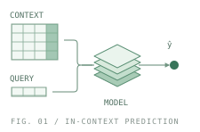

Read an in-context prediction as a mapping from a labelled reference table and new feature rows to a predictive output.

<figure>
  
  <figcaption>The highlighted column in the context table holds the known targets.</figcaption>
</figure>

## Context and query rows

Each context row pairs feature values with a known target. Query rows have the same feature schema, with the target withheld. Feature units, order and categorical encodings must agree between the tables.

## A shared predictor

A pretrained tabular predictor uses the context to interpret the query. In a scikit-learn interface, `fit` supplies the labelled context and `predict` or `predict_proba` requests outputs. The diagram shows information flow; internal attention layouts depend on the model and version.

## Read the prediction

For classification, `predict_proba` returns one probability per class for each query row, in `model.classes_` order. For regression, `predict` returns a numerical response. Hold out data that match the intended deployment setting before evaluating either output.

Follow the [Quickstart](/overview/#quickstart) to see the flow with Iris, or find evaluation designs in the [Reading list](/reference/reading-list/#worked-method-examples).

## Sources

- [TabPFN · implementation and model documentation](https://github.com/PriorLabs/TabPFN)
